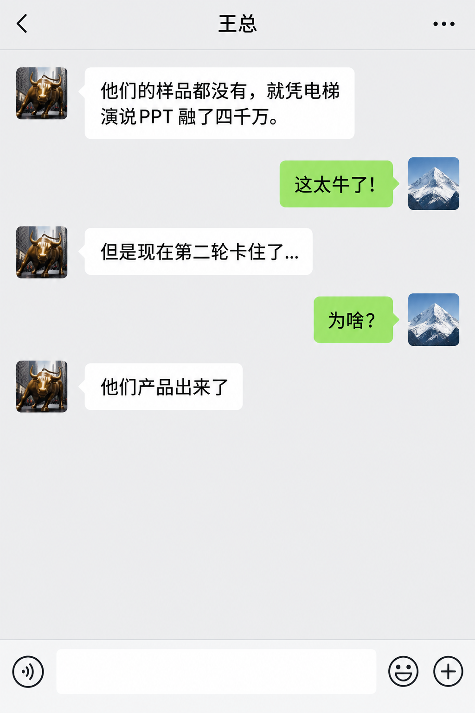
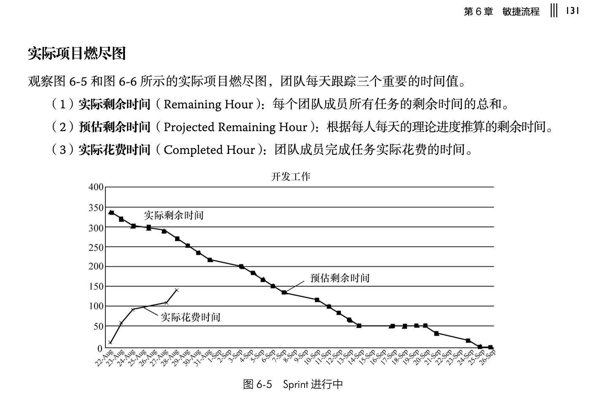

# 智能硬件开发 · 项目计划

（前期的作业：https://gitee.com/zouxin2025/ASE/blob/master/2026-fall-se/homework1-qa.md ）

请提交一个 PPT：

1. 你们项目的基本情况（名字，目标，团队成员介绍，等）
2. 项目的最终目标
   1. NABCD
      1. 你们的典型用户叫什么名字，有什么特点，有什么痛点？她愿意为你的产品付多少钱？
   2. 项目的发布新闻稿
3. 你们项目有多复杂？你们如何降低复杂度，确保按时间交付？
4. 你们项目到 11/16 会有一个 Alpha Release，需要演示 MVP （最小可用产品）的一个成功的场景，这个场景是什么？能用 PPT/纸壳/动画/视频来演示么？
5. 这个 MVP 场景，应该分为多少子模块/更细致的工作？ 可以用 AI 来替你们做第一个版本的 Work-breakdown structure，把问题分解
6. 每个人大致负责哪些模块/任务？ 能在 11/16 前完成么？ 即使 “AI 会写好所有的程序”， 那我们也要做计划， 测试，集成，硬件，用户测试...
7. 如果你们的项目最后失败了， 每个人预估一下，失败的原因是什么 （这叫 pre-mortem 方法，先考虑各种困难和挑战）

## 0. 复杂度分析

进一步细化之前，我们可以对照《构建之法》第四版第 8 章关于复杂度的分类，分析自己的项目复杂度，记住，我们要在剩余的 9 周时间把产品做出来，不能拖延。

- **简单**：需求明确、技术成熟、边界清晰、可预测。做出来就知道对不对，比如一个固定功能的传感器模块，或者重复一个市面上主流智能硬件的基本功能。
- **繁杂（Complicated）**：需求可分解、组件多但关系可枚举、有成熟方法论。虽然繁琐，但是可以拆成很多独立部分，每部分都有成熟解法，比如一个多传感器数据采集系统，或者在市面上成熟的智能硬件的基础上，开发有限的几个扩展功能。
- **复杂（Complex）**：需求动态变化、组件间非线性耦合、结果不可完全预测。各部分互相影响，用户期待、行为、环境、硬件、软件的各种因素交织。
- **混乱（Chaotic）**：需求模糊、边界不清、因果关系不明确、无先例可循。连“要解决什么问题”都说不清，比如“做一个更懂用户的全新架构、全新组合的智能硬件”。

自评之后，团队必须回答三个问题：

- 如果本项目属于“复杂”或“混乱”，你们打算如何收敛问题边界？（例如：精简场景、限定用户、降低技术复杂度、限定功能集）
- 复杂度等级如何影响你们的原型策略？（复杂项目需要更早、更频繁地用纸壳原型接触用户）
- 复杂度等级如何影响你们的调研对象选择？（复杂项目需要覆盖更多不同视角的用户）

如果团队无法就复杂度等级达成共识，说明 NABCD 还没想清楚，要多探索多讨论，keep it simple，聚焦。像软件工程老手的告诫：**不要试图同时爬两棵树，不要试图一天就爬完珠穆朗玛峰**。

**复杂度自评是整份指南的认知基调。** 它决定了 NABCD 的边界、原型策略和调研强度。在软件工程的各个阶段，我们都会都会反复呼应这个分类。

---

## 一、项目信息

在制作原型与接触用户前，团队成员必须确认本项目的基本信息与 NABCD 框架。调研人员必须清楚并高度认同项目的核心定位与边界，不得在调研过程中随意漂移产品范围。

**《构建之法》第四版推荐阅读**：第 8 章“需求分析”，其中 8.3 节“获取用户需求——用户调研”与 8.4 节“竞争性需求分析的核心框架”直接支撑本部分的方法论基础。

### 1. 团队基本信息与代码仓库（报告首部必填）

- **团队名称**：[填写团队正式名称]
- **团队 Gitee 仓库链接**：`https://gitee.com/[组织或用户名]/[项目仓库名]`（确保已添加授课教师/助教为协作者，所有原型照片、调研日志及报告源文件均需 commit 至该仓库）。
- 这个作业需求的链接（链接到老师或助教发的 gitee 文章）

### 2. 选题硬性审查

团队成员要确认，本项目是一个能在 11 周内完成软硬件设计、制造并交付给真实用户的工程产品（符合本次课程要求），本项目不是以个人学术兴趣为主、追求前沿算法，无计划完成软硬件闭环交付的理论探索。这类纯学术探索项目没有具体的应用场景，无法通过“纸壳原型与真实用户调研”获得有效反馈与实质帮助（不符合本次课程要求）。

### 3. 团队 NABCD 框架陈述

用户的反馈是什么呢——“啊，这就是我一直想要的”，还是“我用不着”，还是“你说的是啥啊……”

**复杂度自评决定了 NABCD 的边界。** 复杂/混乱项目的 N 必须收敛到具体场景和具体人群；简单/繁杂项目的 N 可以相对宽泛。

- **N (Need 需求)**：明确界定目标人群的核心痛点。说明该痛点属于刚性需求还是辅助性需求，分析其发生频次与具体使用场景。
- **A (Approach 做法)**：说明团队采用的软硬件技术路线与物理形态定义。针对典型形态（如**桌面管家、桌面宠物、桌面对话模型、自行车新码表、桌面机械臂**），明确其尺寸规格、核心传感器、微控制器与执行机构布局。
- **B (Benefit 好处)**：说明方案带给目标用户的直接收益，分析其收益/成本比（Benefit/Cost），阐明用户替换现有替代方案的具体理由。
- **C (Competitors 竞争)**：（这次练习不是重点）
- **D (Delivery & Data 交付与验证数据)**：（这次练习不是重点）

参考《构建之法》第 8 章内容。

用 NABCD 等方法提炼出来的项目核心特点，能帮助我们高效地交流和凝聚共识，可以在短时间（例如坐电梯的两分钟内）让别人了解。这也因此得名“电梯演说”，当然，口头描绘都是很美好的，我们用各种产品原型来收集用户的反馈，确保我们是“做了用户想要的事”，避免下面的故事：




## 二、工作计划 · Sprint 冲刺

从 WBS（Work-Breakdown Structure）细化到 10 个工作日的计划。根据敏捷项目的要求，把项目需求、个人角色提交 AI，由 AI 给出 10 天 Sprint 每个人的计划工作作为基准。**本 Sprint 计划的核心原则：AI 可以加速“生成”，但“验证”必须由人完成并留下证据；每日记录的是一天里被验证通过的东西，而不是 AI 生成了什么。**

参考《构建之法》6.2 节，我们期待什么样的简单报告： 




### 1. Sprint 目标、责任原则、燃尽图数据口径与每日报告目录

**Sprint 目标（一句话）**：10 天结束时，打通从触发到反馈的端到端闭环，延迟低于 3 秒，可在纸壳场景中演示一遍。

**责任原则（本 Sprint 的基调，全组遵守）**：

> **代码是自己写还是 AI 写，只是执行细节。你是任务的 Owner，就要对这个任务“被验证通过”负全责。**
>
> - AI 生成代码不等于任务完成。任务完成的唯一标准是：**该任务的验证产出物存在、可检查、且被 Owner 本人确认通过**。
> - Owner 不能把“AI 写错了”“AI 生成的代码跑不通”作为未完成的理由。AI 是工具，选它、用它、验它、修它，都是 Owner 的决策和责任。
> - 每日报告里不区分“我写的”和“AI 写的”，只区分“验证通过了”和“还没验证通过”。**代码来源不进入燃尽图，验证状态才进入燃尽图。**
> - 站会上不问“这是谁写的代码”，只问“这个模块验证到了什么程度、还差多少小时、卡在哪”。
> - **AI 是 Owner 手里的工具，不是 Owner 之外的另一个责任人。任务表上写谁的名字，谁就要为“验证通过”负责到底。代码来源不改变责任归属，验证产出物才是唯一的完成证据。**

**燃尽图数据口径**（参考《构建之法》6.2 节，以时间为度量）：

- **实际已消耗时间**：每个人**亲自投入**在该任务上的时间，**不含**等待 AI 生成代码的时间。你等 AI 输出 20 分钟不计入；你花 40 分钟读懂、修改、在硬件上验证这段代码，计入。
- **实际剩余时间**：该任务**距离“可被验证通过”还差多少小时**。
- **预估剩余时间**：按原计划理论进度线性递减的剩余时间线。
- **剩余时间允许上涨，且必须当天记录。** 当验证发现新问题、依赖方延迟、或 AI 生成代码在真实环境中暴露缺陷时，负责人必须当天上调剩余时间，并在阻塞栏写明上涨原因与新增工作内容。**燃尽图向上翘不是失败信号，是真实的进度信号；隐瞒上涨才是失败。**
- 记录时同时保留“已消耗小时”和“剩余小时”两个数。例如：原估 1 小时验证，实际花 1 小时发现问题，认为还需 2 小时——记录为“已消耗 1h，剩余 2h”，总工作量从 1h 变为 3h，燃尽图对应点上翘。
- **预警线**：单个任务剩余时间累计上涨超过原始预估的 100%（如原估 1h、剩余涨到 2h 以上），该任务在站会上必须由全组讨论是否触发第 6 条的砍功能预案或切换人工重写预案。

**燃尽图至少三条线**：预估剩余时间（线性递减）、实际剩余时间（允许上涨）、实际已消耗时间（累计人工投入）。实际剩余时间线向上翘的每个点，必须在每日报告中找到对应的原因记录，助教脚本将做交叉核对。

**团队约定（写进 Sprint 计划，全组遵守）**：“剩余时间上涨”是全组共享的风险信号，不是个人绩效指标。任何成员上调剩余时间并附原因记录，视为对团队进度透明度的贡献；隐瞒上涨、虚报完成，才是对团队最大的伤害。站会上讨论上涨任务时，只讨论“怎么收敛、要不要触发预案”，不讨论“谁的责任”。

**每日报告目录**：`/daily-scrum/`，每人每天一个文件，命名 `DayXX-成员代号.md`。**每份文件由该成员本人提交**，内容责任归属提交者，不是由 Scrum Master 代写或汇总。Scrum Master 的职责是：在 Day 1 前把目录结构和文件模板 commit 到 Gitee 仓库，告知助教抓取路径；每天站会后检查是否所有成员都已提交，对未提交者当天提醒；如果站会上发现某个阻塞项跨多人，Scrum Master 可以在当天新增一个 `DayXX-阻塞汇总.md` 记录该阻塞的跟进状态，但这**不替代**任何人的个人报告。

每份个人报告必须包含：任务名称、验证产出物路径/链接、验证方式、实际已消耗小时、实际剩余小时、阻塞项（如有）。助教脚本抓取的是**“验证产出物路径 + 剩余小时数”**，不是文字描述。

**公开燃尽图页面**：Scrum Master 在 Day 1 前搭建好 Gitee Pages 静态页面（或 Gitee Go 定时流水线），每日站会后自动/手动更新燃尽图。页面 URL 写入仓库 README，全班可访问。更新责任在 Scrum Master，但数据来源是每个人提交的 `/daily-scrum/` 文件——如果某人漏交或数据格式不对，图上对应点会缺失，站会上当场补。具体搭建方式见**附录**。


### 2. 每个人的任务清单（精确到天 + 小时）

任务粒度控制在半天以内，超过 4 小时的任务再拆一步。使用 AI 生成代码的任务，标注“AI 生成?”和“人工验证方式”，用于预估验证工作量；**无论这一列填“是”还是“否”，该任务行的成员都是唯一 Owner，对验证产出物和剩余时间负全责。**

| 日期 | 成员 | 任务 | 人工预估小时 | AI 生成? | 人工验证方式 | 依赖/备注 |
|---|---|---|---|---|---|---|
| Day 1 | A | 确认 BOM 并下单主控+传感器 | 2h | 否 | 订单截图 | 中午前完成，否则影响 Day 3 |
| Day 1 | B | 搭建传感器读取测试环境 | 3h | 否 | 串口有输出截图 | 先用实验室备用模块 |
| Day 1 | C | 确定状态机状态与接口定义，写一页纸验收条件 | 2h | 否 | 文档 commit 至仓库 | 全组 Day 2 前签字确认 |
| Day 1 | D | 搭建执行器测试环境，准备演示脚本框架 | 2h | 否 | 执行器动作照片/视频 | 独立 |
| Day 2 | A | 面包板搭建传感器电路并验证读数 | 4h | 否 | 连续 100 个读数截图，波动范围记录 | 依赖 Day 1 到货或备用模块 |
| Day 2 | B | 传感器采集固件 | 1h（生成）+ **2h（人工验证与修改）** | 是 | 真实传感器接入，串口输出连续 100 个读数，波动范围截图 | 需 A 的电路就绪 |
| Day 2 | C | 状态机骨架代码 | 1h（生成）+ **2h（人工验证与修改）** | 是 | 无硬件输入下用模拟输入跑状态流转，串口日志截图 | 可与硬件并行 |
| Day 2 | D | 执行器驱动代码 | 1h（生成）+ **2h（人工验证）** | 是 | 收到模拟指令后执行器动作的视频/照片 | 独立 |
| Day 3 | A | 结构方案设计并提交 3D 打印文件 | 3h | 否 | 打印文件提交截图 | 外壳打印排队需提前 |
| Day 3 | B | 传感器滤波固件 | 1h（生成）+ **3h（人工调参+实测）** | 是 | 接入真实传感器，对比滤波前后数据，截图 | 需 A 的电路就绪 |
| Day 3 | C | 状态机接入模拟传感器输入联调 | 3h | 部分 | 状态流转日志与预期一致 | 依赖 C Day 2 骨架 |
| Day 3 | D | 反馈输出通道（灯光/显示/动作）驱动整合 | 1h（生成）+ **2h（人工验证）** | 是 | 各反馈通道按指令触发的视频 | 独立 |
| Day 4 | A | 外壳打印取件与试装配，记录公差问题 | 3h | 否 | 装配照片、公差问题清单 | 依赖 Day 3 提交打印 |
| Day 4 | B | 传感器模块稳定性测试（连续运行 1 小时） | 3h | 否 | 1 小时数据记录，无异常截图 | 依赖 B Day 3 |
| Day 4 | C | 状态机异常输入处理（噪声、丢包） | 2h（生成）+ **2h（人工验证）** | 是 | 注入异常输入的日志，状态机不卡死 | 依赖 C Day 3 |
| Day 4 | D | 演示脚本初稿与纸壳场景道具制作 | 3h | 否 | 脚本文档 + 道具照片 | 独立 |
| Day 5 | A | 硬件总装与线缆管理 | 4h | 否 | 整机装配完成照片，整机供电正常 | 依赖 Day 4 外壳 |
| Day 5 | B | 传感器与主控接口对接验证 | 3h | 否 | 主控读到传感器数据的串口截图 | 依赖 A Day 5 总装 |
| Day 5 | C | **端到端联调启动**（集成主责） | 4h | 部分 | **触发到反馈的延迟测量记录**（秒表或日志时间戳） | 依赖 A 总装、B 接口、D 反馈通道 |
| Day 5 | D | 演示脚本走查，反馈表设计与打印 | 2h | 否 | 反馈表文件 + 打印件照片 | 独立 |
| Day 6 | A | 整机稳定性测试，排查装配松动/供电问题 | 4h | 否 | 连续运行记录，问题清单 | 依赖 Day 5 总装 |
| Day 6 | B | 配合联调修复传感器相关问题 | 3h | 部分 | 修复后复测截图 | 依赖 C 联调反馈 |
| Day 6 | C | **端到端联调**，延迟优化至 < 3 秒 | 5h | 部分 | 延迟测量记录，多次测量取中位数 | 关键路径 |
| Day 6 | D | 备份视频录制（第一版） | 2h | 否 | 视频文件路径 | 依赖 Day 5 联调可用 |
| Day 7 | A | 配合联调修复硬件相关问题 | 3h | 否 | 修复后复测记录 | 依赖 C 联调反馈 |
| Day 7 | B | 传感器数据在整机环境下的最终验证 | 3h | 否 | 整机运行下传感器读数记录 | 依赖 A 整机 |
| Day 7 | C | **端到端联调收尾**，确认三条验证链全部通过 | 4h | 部分 | 联调通过记录，延迟测量最终版 | 关键路径 |
| Day 7 | D | 演示脚本定稿，纸壳场景完整走查 | 2h | 否 | 走查记录 | 依赖 C 联调 |
| Day 8 | 全员 | **集成缓冲日**：修复 Day 5-7 联调遗留问题 | 各 4h | 部分 | 问题清单逐项关闭记录 | 缓冲 |
| Day 9 | 全员 | **集成缓冲日**：整机演示彩排，备份视频定稿 | 各 4h | 否 | 彩排记录、最终视频文件 | 缓冲 |
| Day 10 | 全员 | **Alpha Release 演示**，收集用户反馈 | 各 3h | 否 | 至少 5 份有效反馈表 | 交付 |

**说明**：“AI 生成?”列仅标注该任务的代码主要来源，用于预估验证工作量，**不改变责任归属**。每一行的成员是该任务的唯一 Owner，对该任务的验证产出物和剩余时间负全责。自己写还是 AI 写，是 Owner 的执行选择，不是责任转移。


### 3. 依赖关系与关键路径标注

**关键路径**：A 的硬件总装（Day 5）→ C 的端到端联调（Day 5-7）→ 全员缓冲（Day 8-9）→ 演示（Day 10）。

**关键依赖**：

- C 的端到端联调（Day 5-7）依赖 A 的硬件总装完成（Day 5 下班前）。A 延迟一天，C 的联调窗口少一天，直接压缩 Day 8 缓冲。
- C 的联调同时依赖 B 的传感器接口验证（Day 5）和 D 的反馈通道整合（Day 3 完成、Day 5 可用）。
- A 的外壳打印（Day 3 提交、Day 4 取件）不阻塞核心闭环验证——若打印延迟，先用纸壳/亚克力手工切割替代，3D 打印作为升级项而非阻塞项。
- D 的备份视频（Day 6 第一版、Day 9 定稿）依赖 C 的联调可用状态。

**验证依赖（针对 AI 场景额外强调）**：C 的联调依赖的是 A 的硬件**经过通电验证**、B 的传感器**经过读数验证**、D 的执行器**经过动作验证**。任何一个人只让 AI“生成了代码”而没有完成验证，C 的联调就无法开始。**未经验证的代码等同于没做**，这是本 Sprint 的硬规则。


### 4. 每日可检查的产出物（Definition of Done）

每一天结束时，**每个人**在 `/daily-scrum/DayXX-成员.md` 中提交的产出物必须包含以下三项，缺一不可：

**① 今天被验证通过的东西（附证据链接或文件路径）**

- 如果今天你让 AI 生成了代码：证据是**这段代码在真实环境中的运行结果**（串口截图、视频、日志文件）。
- 如果今天做的是硬件：证据是**照片或测量记录**。
- 如果今天做的是集成：证据是**延迟测量记录**。
- 报告中**不需要说明代码是自己写的还是 AI 写的**。只需要写清楚：验证了什么、证据在哪、还剩多少小时。

**② 实际已消耗小时 + 实际剩余小时**

- 剩余时间**允许上涨**。当验证发现新问题、依赖延迟或 AI 生成代码暴露缺陷时，当天上调剩余时间，并在阻塞栏写明上涨原因与新增工作内容。记录时同时保留“已消耗”和“剩余”两个数。
- 任务已完成填剩余 0。任务卡住填当前预估，并在阻塞栏写明原因。
- 单个任务剩余时间累计超过原始预估 100% 时，站会全组讨论是否触发砍功能或人工重写预案。

**③ 阻塞项（如果有）**

明确写“我卡在什么上，需要谁在什么时候之前提供什么”。

**示例（可直接用于助教脚本抓取）**：
```
Day 2 / C
任务：状态机骨架
验证产出物：/evidence/day2-state-machine-simulated-input.log
验证方式：用模拟传感器输入序列跑状态机，串口打印的状态流转与预期一致
已消耗：1h（生成）+ 2h（读懂、修改、跑模拟验证）
实际剩余：2h（还需接入真实传感器信号验证）
阻塞：无
```

**不接受的报告内容**：
- “今天让 AI 写了状态机代码，看起来没问题。”——没有验证证据，不算完成。
- “这段是 AI 写的，还没验证，等它再生成一版看看。”——AI 生成不是验证，Owner 必须亲自在真实环境中确认它是否可用。


### 5. 每日站会安排与风险上报机制

**站会时间**：每天上午 9:30，10 分钟。指定一人（组长或轮值）记录阻塞项，当天内解决或上报。

**站会前 5 分钟（Scrum Master）**：运行脚本抓取 Day 1 至 Day n-1 的每日报告数据，生成/更新燃尽图页面，投屏或发到群里。全班可通过 Gitee Pages 公开链接查看当前燃尽图。

**站会前 2 分钟（全组看板）**：看燃尽图，确认实际剩余时间线的翘点是否都有对应的原因记录。没有记录的，当场问责任人补。

**三个固定问题（针对 AI 辅助场景改写）**：

1. **昨天你负责的模块，被验证到了什么程度？**（不是“你写了什么”）
2. **今天你计划验证什么？验证需要谁配合？**（不是“今天你写什么”）
3. **有没有“AI 生成了但没人验证过”的代码在队列里？**

**站会纪律**：不讨论“这是人写的还是 AI 写的”。只讨论“验证到了什么程度、还差多少、卡在哪、需要谁配合”。代码来源是执行细节，验证状态才是站会要检视的进度信号。

**风险标记规则**：如果某天站会发现“有 AI 生成的代码已经存在超过 24 小时但未被验证”，该代码对应的任务标记为“风险”。未经检验的代码是隐性技术债，越积越多会在联调时集中爆发。

**上涨任务讨论规则**：站会上讨论剩余时间上涨的任务时，只讨论“怎么收敛、要不要触发预案”，不讨论“谁的责任”。上涨是风险信号，不是绩效指标。

**站会后（Scrum Master）**：把当天燃尽图截图存入 `/daily-scrum/`，标注当天讨论的阻塞项和预案触发情况。


### 6. 缓冲与砍功能预案

**缓冲安排**：Day 8-9 为集成缓冲日，不排新的功能开发，专门用于关闭 Day 5-7 联调遗留问题、整机彩排、备份视频定稿。10 天 Sprint 不排满，预留约 1.5 天缓冲。

**砍功能优先级**（若 Day 6 联调发现延迟超标或时间不足）：

1. 先砍**额外音效、屏幕动画**等非核心反馈通道，保灯光/核心动作反馈。
2. 再砍**非核心状态分支**，状态机只保留主流程。
3. 外壳精细度降级：纸壳/亚克力手工切割替代 3D 打印，不作为阻塞项。
4. **底线**：核心闭环（触发→感知→决策→反馈）和延迟 < 3 秒必须保住，这是演示成功的最低条件。

**AI 相关预案**：如果 Day 5 联调发现某个模块的 AI 生成代码在真实硬件上表现不稳定（例如状态机在传感器噪声下卡死），**优先切换到“人工重写该模块核心逻辑”**，而不是继续让 AI 反复生成修复版本。触发条件：**同一模块的 AI 修复尝试超过 2 轮仍未通过验证**。在时间压力下，人工重写一个已理解边界条件的状态机，比反复调试 AI 生成的黑盒代码更可控。这个切换决策由该模块的 Owner 提出、全组确认。Owner 对“继续用 AI 修”还是“人工重写”负责——**不能因为“AI 还没修好”而让任务无限期挂起**。Owner 的责任是让任务通过验证，不是让 AI 把代码生成出来。

**预案触发机制**：任何成员在每日报告中上调剩余时间超过预警线，或站会发现关键路径任务阻塞，由组长当天召集 10 分钟短会，决定是否触发上述预案，并记录在 `/daily-scrum/` 当天的团队决策日志中。


### 附录：燃尽图自动生成与全班可见的搭建方式

**目标**：全班任何人通过一个固定 URL，能看到团队每天更新的燃尽图（三条线：预估剩余、实际剩余、实际已消耗）。数据来源是 `/daily-scrum/` 下每个人提交的 Markdown 文件。

#### A.1 整体链路

```
/daily-scrum/DayXX-成员.md
        ↓ （Python 脚本解析“已消耗”“剩余”字段）
   burndown_data.json（可选中间产物）
        ↓ （matplotlib 生成折线图 → 嵌入 HTML）
   burndown.html
        ↓ （git push 到 Pages 分支）
Gitee Pages 自动托管 → 全班访问固定 URL
```

#### A.2 方案选择（按团队技术能力选一档）

**方案 A：手动推送（最低成本，约 30 分钟搭建）**

Scrum Master 本地写一个 Python 脚本（可让 AI 生成），功能：遍历 `/daily-scrum/` 下所有 `DayXX-*.md`，用正则提取“已消耗小时”和“实际剩余小时”，按天汇总，用 `matplotlib` 画三条折线，保存为 `burndown.png`，同时生成一个极简 `burndown.html` 引用该图片。然后执行 `git add → commit → push` 到 Gitee 仓库的 Pages 分支（如 `gh-pages` 或 `master`）。Gitee Pages 开启后，全班访问 `https://<用户名>.gitee.io/<仓库名>/burndown.html` 即可看到。

**注意**：Gitee Pages 目前可能需要实名认证才能开通，且仓库需为公开。如果认证卡住，立即切方案 B 或备选。

**方案 B：Gitee Go 定时自动触发（多花约 1 小时配置，之后零手动）**

在仓库中新增一个 Gitee Go 流水线描述文件（YAML 格式），配置**定时触发**（cron 表达式）。流水线步骤：检出代码 → 安装 Python 和依赖 → 运行燃尽图生成脚本 → 将生成的 `burndown.html` 和 `burndown.png` commit 并 push 到 Pages 分支。Gitee Go 支持定时触发流水线，cron 表达式格式为 `M H D m d y`，例如 `0 30 9 * * ?` 表示每天 9:30 触发。

**方案 C（备选）**：如果 Gitee Pages 实名认证流程影响进度，改用腾讯云 COS 或阿里云 OSS 的静态网站托管，手动上传 `burndown.html` 和 `burndown.png`。成本极低，但域名较长且需要额外配置。

#### A.3 燃尽图生成脚本的核心逻辑（伪代码，可交给 AI 实现）

```python
# 1. 读取 /daily-scrum/ 下所有 DayXX-*.md
# 2. 对每个文件，用正则提取：
#    - 已消耗小时: r"已消耗[：:]\s*([\d.]+)"
#    - 实际剩余: r"实际剩余[：:]\s*([\d.]+)"
# 3. 按天汇总：Day1 到 Day10 每天的“团队总已消耗”和“团队总剩余”
# 4. 计算预估剩余线：Day1 初始总预估 / 10 * (10 - day_index)
# 5. 用 matplotlib 画三条折线：
#    - x 轴: Day1~Day10
#    - y 轴: 小时
#    - 线1（虚线）: 预估剩余
#    - 线2（实线，允许上翘）: 实际剩余
#    - 线3（实线）: 实际已消耗
# 6. 保存 burndown.png + 生成 burndown.html（嵌入图片，附当日数据表）
# 7. （可选）将 burndown.html 和 burndown.png commit 到 Pages 分支
```

**数据健壮性处理**：如果某人某天未提交报告或格式不匹配，脚本应在图上标注“缺失”并在 HTML 页面列出缺失名单，而不是静默跳过。这样站会上能直接看到谁漏交了。

#### A.4 给助教的抓取路径说明

在仓库 README 中明确写入：

> **每日报告目录**：`/daily-scrum/`
> **文件命名规则**：`DayXX-成员代号.md`（XX 为两位数，如 Day01、Day02）
> **燃尽图公开页面**：`https://<用户名>.gitee.io/<仓库名>/burndown.html`
> **数据字段**：每个文件包含 `已消耗：Xh` 和 `实际剩余：Yh` 两行，脚本按此格式抓取。

如果助教脚本需要独立验证，可让它直接拉取 `/daily-scrum/` 原始文件自行计算，与团队页面做交叉核对。**团队页面用于“全班可见和学习”，助教脚本用于“进度真实性核查”，两者数据来源相同但独立运行，互相印证。**